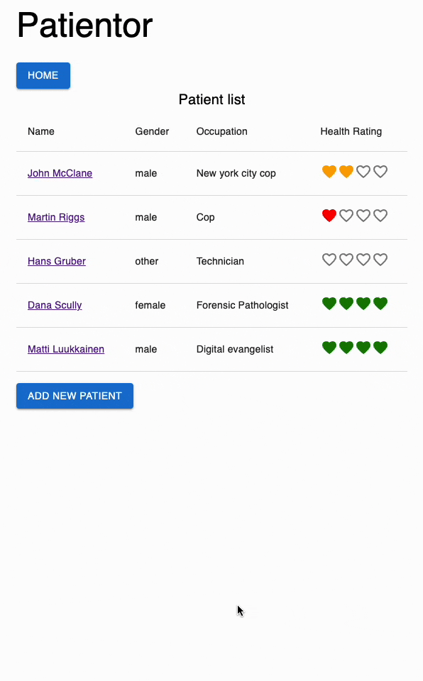

# Patientor: a patient record system

[https://patientor-v1.azurewebsites.net/](https://patientor-v1.azurewebsites.net/)

## Project description

The project is a patient record system that allows users to view and add patient records. The data is stored in a JSON file and the application is built using React.

## Prerequisites

- Node.js 24

## Getting started

### Production

1. Clone the repository and `cd` to it
2. Run `npm ci` to install the backend dependencies
3. Run `npm ci --prefix patientor-frontend` to install the frontend dependencies
4. Run `npm run build` to compile the backend and frontend
5. Run `cp -R patientor-frontend/dist ./dist` to place the frontend where Express serves it
6. Run `npm start` to start the server

### Deployment

The Azure deployment runs the public
`ghcr.io/chenxu2394/patientor` container on a Bicep-managed F1 App Service.
GitHub Actions uses secretless OIDC authentication for Azure and deploys an
immutable commit-SHA image. See [the deployment guide](docs/deployment.md)
for configuration, GitHub package access, one-time OIDC bootstrap, deployment,
and verification.

### Development

1. Clone the repository and `cd` to it
2. Run `npm install` to install the backend dependencies
3. Run `npm run dev` to start the backend in development mode
4. In a new terminal `cd patientor-frontend` to go to the frontend directory
5. Run `npm install` to install the frontend dependencies
6. Run `npm run dev` to start the frontend in development mode

> This project is based on [FullStackOpen](https://fullstackopen.com/en/), with additional infrastructure and deployment work.
